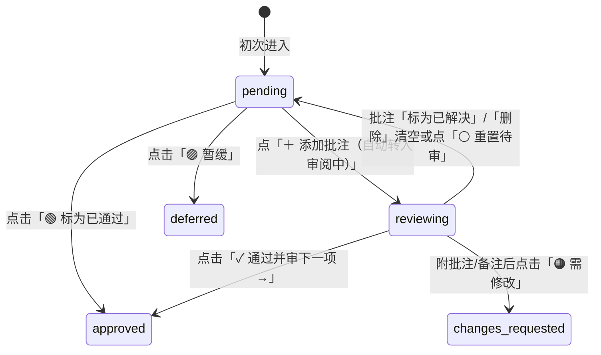
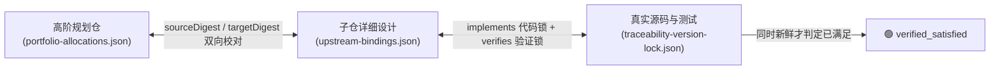

# Skill Family Studio 操作手册（零基础逐按钮指南）

> 不用背命令行、不用猜读取顺序——一个本地端口统一搞定跨仓需求对齐、故事优先审阅、多波次任务树与多智能体会话编队。

## 一、这款工具解决什么问题

无论是独自维护一个技能族仓库，还是协助管理“1 个高阶规划仓 + 多个子技能族详设仓”的业务域套组，初次打开或验收项目时最常遇到五个困惑：不知道先对智能体说什么就能打开界面、不知道上百份文档该从哪篇读起、分不清哪条需求只是“派了单”还是“真写完了代码并跑通测试”、看不清长任务执行树推进到哪一步以及派出去的多个子智能体正在干什么、还经常在点击图表或目录时被页面跳回顶部打断阅读。

Skill Family Studio 把这些场景全部收拢进单一本地回环端口（默认 127.0.0.1:57630）：左上角通过「当前项目：<仓库名> ▾」切换仓库，中间固定「📖 使用说明」「🕸️ 制品图谱」「📝 逐项审阅」「⚡ 运行监控」四个主页签，右上角点击「审阅进度：… 导出 ▾」随时查看当前仓进展并导出全部受管仓库的验收单。界面中徽章与操作旁都紧贴「ⓘ」图标（悬停预览、点击固定，按 Escape 收起）；所有批注和结论均保存在 Studio 自管目录（默认 .skill-family-studio/reviews.json），绝不改动任何受审仓库受 Git 跟踪的文件。

## 二、零门槛开启：直接对智能体说一句话即可

你不需要记住任何启动参数，也不用先写配置文件。在正在工作的项目目录里直接对你的智能体（如 Antigravity / Claude Code / Codex）说出你的意图即可：

| 你的目的 | 对智能体说的一句话示例 |
| --- | --- |
| 想看全盘结构或开始审阅 | “打开工作台，带我看下这个项目的设计。” |
| 想核对需求拆分与实现对齐 | “打开逐项审阅，帮我核对需求进展和代码锁有没有漂移。” |
| 想盯长程任务和多智能体协作 | “打开运行监控，看看任务推进树和派出去的子会话跑到哪一步了。” |

- 第一步（静默体检）：智能体先只读运行环境探针（inspect-setup），自动识别当前目录属于单技能族仓库、高阶规划仓、详设子仓还是多仓父目录，同时探测是否已经绑定了上下游仓库或存在活跃运行源。
- 第二步（智能决策）：如果是无上下游绑定的单技能族项目，智能体默认只扫描当前这一个仓库（--scan-roots none），避免把父目录里无关仓库全塞进下拉框，直接拉起控制台并给你一条明确的固定审阅路线。
- 第三步（仅当必要时问一道三选题）：如果检测到当前仓已与上下游仓关联但还没有 .studio-workspace.json，智能体只用大白话问你一次三选一：① 仅聚焦当前仓；② 自动纳入关联上下游仓以支持跨仓互跳；③ 指定业务域扫描目录并由智能体代写配置。

### 两种工作模式（由智能体自动适配或代配）

#### 单技能族项目模式（聚焦本仓、零配置即开）

- **适用读者**：适合独立开发或验收单一技能族的开发者与审阅者
- **何时选用**：当你只关心当前这一个仓库里的“用户故事 / 需求 → 详设 → 代码与测试锁”闭环时使用。
- **工作方式**：系统自动只读取本仓 artifact-graph.config.yaml 与标准 artifacts/ 目录（故事、需求、场景、架构与代码测试锁），不混入父目录里其他项目，同时在「📝 逐项审阅」体检本仓核心源码和 SKILL.md 入口是否都已被版本锁认领。

#### 业务域多仓套组模式（1 个高阶规划仓 + N 个子技能族详设仓）

- **适用读者**：适合跨仓规划架构师、产品负责人与多仓协同团队
- **何时选用**：当一个业务域由“1 个高阶规划仓（总体需求与业务闭环） + 多个子技能族仓（各自落地详设与代码）”组成时使用。
- **工作方式**：由智能体代写或在项目根目录放置 .studio-workspace.json（也可写在 artifact-graph.config.yaml 顶层 studio 节），声明跨组扫描目录 scanRoots、自然分组名 groupLabels 与扩展故事/Archify 集合 collections。即可在同一界面查看「需求进展与双向对齐总览表」并实现一键跨仓互跳。

## 三、按你的角色与来意选一条动线（一步一按钮，绝不踩空）

### 动线一：产品负责人 / 业务需求验收（4 步闭环）

> 适合刚接手项目、需要按“诉求 → 拆解去向 → 验收结论”系统过一遍全部设计的人，照着顺序点按钮走完即可，无需自由抽样。

1. **在顶栏左上角确认当前项目**：点击左上角「当前项目：<仓库名> ▾」展开列表，可用顶部「输入仓库名或关键字过滤…」筛选并查看右侧「已审 X/Y」；点空白处或按 Escape 收起。紧邻其右是「[角色徽章] ⓘ」和「[版本锁状态] ⓘ」。（界面实操按钮：**`打开项目切换器 ▾`**）
2. **核对「📋 需求进展与双向对齐总览」**：切到「📝 逐项审阅」，点击「📋 需求进展与双向对齐总览」（高阶仓进入即默认停在此视图；子仓与单仓需点击该按钮切换）。高阶仓看 4 列表格（高阶需求条目 / 业务处置与承接去向 / 满足概况（机器派生） / 阶段与双向健康度），可用「🔴 双向告警」筛选并点「↗ <子仓名> · <编号>」跨仓互跳；单仓与子仓看下方代码锁体检。（界面实操按钮：**`查看需求对齐总览 →`**）
3. **按「故事 → 需求 → 场景」批注并签收**：点击本页右上「▶ 跳至下一项待审条目 →」（或使用说明页顶部「▶ 开始按推荐顺序审阅（故事 → 需求 → 场景）」）自动跳过 .json/.yaml 契约并带你逐篇读完 Markdown 文稿。点段落旁「#章节批注」填写问题后点击「＋ 添加批注（自动转入审阅中）」自动点亮「🔵 审阅中」；退回时先写至少一条批注或「审阅结论备注」再点「🟠 需修改」；确认无误点「✓ 通过并审下一项 →」（误点可点顶部「撤销并回到该篇」或停靠栏「⚪ 重置待审」）。（界面实操按钮：**`开始逐篇批注签收 →`**）
4. **导出全部受管仓库审阅验收单**：点击右上角「审阅进度：已通过 X · 审阅中 Y · 需修改 Z · 暂缓 W / 共 N 项  导出 ▾」拉起右侧导出抽屉，点击「📋 一键复制 Markdown 验收单」（按钮提示「✓ 已复制」）或「⬇ 下载 Markdown 验收单」/「⬇ 下载 JSON 台账」，点「关闭 ✕」或按 Escape 退出。（界面实操按钮：**`打开验收单导出抽屉 →`**）

### 动线二：架构师 / 技能族开发者（3 步全局对齐与排错）

> 适合改完详细设计或新增代码与技能入口后，快速确认上下游依赖没断链、代码已被版本锁认领、没有跨仓漂移。

1. **在「🕸️ 制品图谱」看全局依赖与业务逻辑图**：点击工具栏「制品依赖图谱 (N)」看 6 层依赖，点击任意节点全图坐标 100% 恒定不跳动并在右侧联动正文；可使用「适应屏宽」「自动折行排布」「仅看上下游关联子图」「－ / 100% / ＋」（或 Ctrl/Cmd + 滚轮）「重置视图」与「全屏画布」。若仓库配有多张业务图，可切「Archify 业务逻辑图 (M)」并用「◀ 上一张 / 下一张 ▶」切换。（界面实操按钮：**`打开宽屏制品图谱 →`**）
2. **检查代码锁认领与双向漂移**：进入「📝 逐项审阅」→「📋 需求进展与双向对齐总览」，核对 UNALLOCATED_ACTIVE_DEMAND、UPSTREAM_DESIGN_CHANGED、DOWNSTREAM_DESIGN_EVOLVED 与下方单仓内部体检的 UNCLAIMED_IMPLEMENTATION_ENTRY（悬停「ⓘ」即可看人话定义）。（界面实操按钮：**`核对代码锁认领体检 →`**）
3. **跨仓对照正文并核对同源 JSON 契约**：点总览表「↗ <子仓名> · <编号>」或子仓正文顶部「↖ <高阶仓名> · <编号>」跨仓对照原文；核对字段约束时点击正文互跳条「🗂️ 查看对应的结构化数据契约（...）→」或「📖 切换到对应的人读版 Markdown 文档（...）→」，并在「📊 结构化可读摘要」与「{ } 原始源码」间切换。（界面实操按钮：**`定位跨仓/告警条目对照 →`**）

### 动线三：长程任务与多智能体监督（3 步盯控）

> 适合你让主智能体拆了好几个波次或派出一队子智能体干活，想直观掌握推进卡点、协作往来和每条委派详情时使用。

1. **看「🌳 任务推进树（默认）」确认当前处于哪一环节**：进入「⚡ 运行监控」默认停在此视图。顶部焦点横幅展示正在执行的路径与总百分比；下方可用「全部任务树」「仅看未完成」「聚焦当前活跃链路」与「按波次、编号或步骤关键词过滤…」过滤，点「▾ / ▸」展开波次与前置依赖；工具栏支持「聚焦当前项目 / 全工作区监控源聚合」「+ 挂载运行源」与「▶ 运行隔离沙箱演练」。（界面实操按钮：**`打开任务推进树 →`**）
2. **看「🛰️ 会话与子会话编队」掌握多智能体协同全貌**：切到第 2 子页签，顶部下拉切换不同宿主编队或点「↻ 刷新日志」；点击「🕸️ Agent 会话网络」卡片或「🔀 跨会话协作泳道」行首标签可锁定会话（出现「已锁定会话：<名称> ×」），泳道支持「搜索会话…」「最早」「最新」；右下「📋 协作任务」与底部「🔎 事件检查」支持「搜索事件内容…」及正文「原文」「Markdown」「📋 复制」。（界面实操按钮：**`打开会话编队面板 →`**）
3. **仅在疑似卡死或超时时点开「🩺 底层排障与健康诊断」**：日常监督无需点开第三子页签；当标签出现「(⚠️ N)」或任务长久停滞时点开，查看顶部健康绿/黄条、文件锁雷达（「全部锁（含版本锁）」/「仅看活跃排他锁」每秒读秒）、state-store 哈希链与 supervise-process 轨迹。沙箱演练锁可在顶栏或锁雷达直接点击「🔓 释放沙箱锁」解除。（界面实操按钮：**`打开底层排障诊断 →`**）

## 四、逐页界面全拆解（每个区域是什么、什么时候看、怎么用）

### 全局顶栏（所有页面固定可见）

- **什么时候看这里**：无论处于哪个页签，随时切换仓库、识别角色健康度和导出成果。
- 左侧「当前项目：<仓库名> ▾」切换器（支持顶部「输入仓库名或关键字过滤…」与右侧「已审 X/Y」）+「[角色徽章] ⓘ」+「[版本锁状态] ⓘ」；点空白或按 Escape 收起。
- 居中四大固定页签：「📖 使用说明」「🕸️ 制品图谱」「📝 逐项审阅」「⚡ 运行监控」。
- 右侧进度胶囊「审阅进度：已通过 X · 审阅中 Y · 需修改 Z · 暂缓 W / 共 N 项  导出 ▾ ⓘ」（点击展开全部受管仓库导出抽屉，含「📋 一键复制 Markdown 验收单」「⬇ 下载 Markdown 验收单」「⬇ 下载 JSON 台账」「关闭 ✕」）与「🌓 外观」。
- **直达操作按钮**：**`打开项目切换器 ▾`**

### 🕸️ 制品图谱页（全局结构与关系视图）

- **什么时候看这里**：第一次熟悉陌生项目架构、核对需求到场景/测试的连线、或对照 Archify 业务逻辑图阅读时使用。
- 工具栏左区：「制品依赖图谱 (N)」与「Archify 业务逻辑图 (M)」（有业务图时出现，旁附「ⓘ」）以及「▶ 开始按推荐顺序审阅」。
- 工具栏右区：DAG 模式下为「适应屏宽」「自动折行排布」「仅看上下游关联子图」「－ / 100% / ＋」（另支持 Ctrl/Cmd + 滚轮与画布拖拽）「重置视图」「全屏画布」；Archify 模式下多图时显示「◀ 上一张」、下拉框、「下一张 ▶」与「全屏画布」。
- 防跳变定位条与右侧联动区：点击任意节点画布坐标 100% 不动，上方刷新当前位置上下游计数，全屏时可点「退出全屏对照右侧正文 →」回到双栏对照。
- **直达操作按钮**：**`前往制品图谱 →`**

### 📝 逐项审阅页（核对齐与批注签收主阵地）

- **什么时候看这里**：需要核对需求是否真正拆分并满足、逐篇阅读设计文档写修改意见并签署结论时使用。
- 顶部双视角切换条：「📋 需求进展与双向对齐总览」「📖 按阅读任务逐篇审阅」与右上角「▶ 跳至下一项待审条目 →」。对齐页高阶表含「全部」「🔴 双向告警」「⏳ 推进/部分」「🟢 已验证满足」「⚪ 按处置不计」筛选、「按需求编号/目标仓搜索…」与 4 列对照及跨仓跳转胶囊；子仓显示 3 列上游绑定表；底部为单仓代码锁 4 项 KPI。
- 逐篇阅读左目录：支持「按编号或标题搜索审阅项…」、3 组分类胶囊（「首要阅读」「关联依据」「结构化数据契约 (.json/.yaml · 供脚本校验)」）与「状态过滤」下拉框；长文支持左右/右栏粘性停靠边看边批注。
- 正文操作条与停靠批注区：顶部提供「✓ 通过并审下一项 →」（含 6 秒「撤销并回到该篇」）与「放宽行宽 / 恢复舒适行宽」及同源「📖 切换到对应的人读版 Markdown 文档」「🗂️ 查看对应的结构化数据契约」「📊 结构化可读摘要 / { } 原始源码」「↖ 上游高阶来源」；正文支持「#章节批注」直传真实锚点；停靠栏提供「🟢 标为已通过」「🔵 标为审阅中」「🟠 需修改」「🟣 暂缓」「⚪ 重置待审」「审阅结论备注」「＋ 添加批注（自动转入审阅中）」与「标为已解决 / 重新打开 / 删除」。
- **直达操作按钮**：**`前往逐项审阅 →`**

### ⚡ 运行监控页（三大场景化观测视图）

- **什么时候看这里**：需要实时盯控长程任务树、追踪多智能体会话委派与回报、或排查卡死锁冲突时使用。
- 顶栏三大一级视图与全局动作：「🌳 任务推进树（默认）」「🛰️ 会话与子会话编队 (N)」「🩺 底层排障与健康诊断」，右侧常驻「SSE 实时同步」「▶ 运行隔离沙箱演练」（及沙箱锁持有时的「🔓 释放沙箱锁」）。
- 🌳 任务推进树 & 🩺 底层排障：自带局部运行源范围条（「聚焦当前项目 / 全工作区监控源聚合」、运行源下拉框、「+ 挂载运行源」）；任务树支持「全部任务树」「仅看未完成」「聚焦当前活跃链路」与「按波次、编号或步骤关键词过滤…」；排障自带健康汇总条、锁雷达（「全部锁（含版本锁）」「仅看活跃排他锁」「🔓 释放沙箱锁」）、state-store 哈希链与 supervise-process 轨迹。
- 🛰️ 会话与子会话编队：顶部独立提供宿主编队下拉框与「↻ 刷新日志」，含 4 项统计 KPI、「🕸️ Agent 会话网络」（点击卡片坐标不变、出现「已锁定会话：<名称> ×」）、「🔀 跨会话协作泳道」（「搜索会话…」「最早」「最新」）、「📋 协作任务」（「全部 / 运行中 / 待处理 / 已完成」）与「🔎 事件检查」（「全部 / 消息 / 回报 / 委派」「搜索事件内容…」「原文 / Markdown / 📋 复制」）。
- **直达操作按钮**：**`前往运行监控 →`**

## 五、状态流转图、三层双向互锁原理图与防呆速查

### 1. 审阅四态自动与手动迁移图



| 状态标识 | 触发与自动感知条件 | 业务含义 |
| --- | --- | --- |
| **⚪ 待审阅** (`pending`) | 尚未写过任何未解决批注，也未给出终态审阅结论；或者点击「⚪ 重置待审」清空备注并清除旧结论（此前批注亦已全部标为已解决/删除）。 | 表示这篇制品还没有进入实质审阅，会排在「▶ 跳至下一项待审条目 →」队列最前面。 |
| **🔵 审阅中** (`reviewing`) | 阅读时点击「＋ 添加批注（自动转入审阅中）」新增至少 1 条未解决批注（自动感知点亮），或主动点击「🔵 标为审阅中」。 | 表示审阅者正在边读边记问题、尚未定稿收尾；一旦所有批注「标为已解决」或「删除」清空且未给终态结论，会自动回到「⚪ 待审阅」。 |
| **🟠 需修改** (`changes_requested`) | 写好至少一条批注或填写上方「审阅结论备注」后点击「🟠 需修改」提交结论（若批注与备注全空，系统会自动拦截提示以防误标空退回）。 | 明确要求作者依据批注返工修订，导出验收单时会归入待整改项。 |
| **🟢 已通过 / 🟣 暂缓** (`approved / deferred`) | 主动点击「🟢 标为已通过」（或顶部「✓ 通过并审下一项 →」，支持 6 秒内「撤销并回到该篇」）完成签收，或点击「🟣 暂缓」留待后续轮次。 | 当前轮次已有明确裁决，自动引导动线会跳过该篇并定位下一篇未签收条目。 |

### 2. 高阶 ⇄ 详设 ⇄ 代码测试三层双向互锁闭环图



| 满足概况徽章 | 机器派生依据与业务含义 |
| --- | --- |
| **🟢 已验证满足** (`verified_satisfied`) | 下游全部承接目标存在、上下游摘要双向一致，且下游仓库的 traceability-version-lock.json 同时具备新鲜的 implements 代码锁与 verifies 测试验证锁（只读冻结仓含有效的 verifiedReceiptPath 验证收据）。绝不靠手工台账声称满足。 |
| **🔵 部分覆盖** (`partially_allocated`) | 需求已拆出部分下游承接，但 remainingScope 仍列有未覆盖的剩余范围，界面会逐条标出尚未落地的部分。 |
| **⏳ 已派单推进中** (`allocated_in_progress`) | 需求已分配给下游技能族仓，但下游目标尚在完善、存在摘要漂移，或下游代码与测试锁尚未齐全验证。 |
| **⚪ 按处置不计满足** (`not_applicable`) | 该需求被明确处置为暂缓（deferred）、合并（merged）或废弃（abandoned），不会混入已满足比例中虚增进度。 |

| 告警徽章与错误码 | 识别到什么问题 | 推荐处理动作 |
| --- | --- | --- |
| **🔴 高阶漏拆** (`UNALLOCATED_ACTIVE_DEMAND`) | 高阶规划仓中有活跃（allocated）需求，但 allocations 列表为空，还没有任何子项目认领。 | 补齐目标子项目承接关系，或在详设确认后暂缓/合并该需求。 |
| **🟠 高阶已变待同步详设** (`UPSTREAM_DESIGN_CHANGED`) | 高阶需求原文自上次绑定以来发生过修订，子项目的详细设计尚未同步更新摘要。 | 点击下游胶囊跨仓进入子项目核对变动并更新详设与 upstream-bindings.json。 |
| **🟠 详设已演进待回写高阶** (`DOWNSTREAM_DESIGN_EVOLVED`) | 子项目在编写手册或实现中演化了详设内容，但高阶规划仓的 portfolio-allocations.json 记录的还是旧摘要。 | 点击「↖ 上游高阶来源」回到高阶规划仓核实影响，并刷新双向绑定锁。 |
| **🟠 单仓代码/技能未认领** (`UNCLAIMED_IMPLEMENTATION_ENTRY`) | 单仓匹配 implementationSurface.entryGlobs 的核心源码或 SKILL.md 入口文件，尚未在 traceability-version-lock.json 中绑定任何 @feature / @scenario 锁。 | 在对应源码或技能顶部补齐追溯注解并运行 artifact-graph version-lock refresh --all。 |

### 3. 常用操作防呆与快捷键速查

| 快捷键 / 触发行为 | 精确结果与防呆保护 |
| --- | --- |
| `Escape` | 按优先级依次关闭当前打开的浮层或全屏视图：「ⓘ」解释气泡 → 「+ 挂载运行源」弹窗 → 导出抽屉 → 「当前项目」下拉 → 图谱「全屏画布」。 |
| `Enter（审阅结论备注框内）` | 立即保存备注与当前结论；若批注输入框中仍有未点击添加的草稿，会先自动保全并落盘，绝不静默丢字。 |
| `Ctrl / Cmd + 滚轮（制品依赖图谱）` | 平滑缩放 DAG 画布（40%–240%），点百分比按钮「100%」可一键还原，或按住空白处拖拽平移。 |
| `批注防丢字与空退回拦截` | 在批注框写了文本却忘记点击「＋ 添加批注（自动转入审阅中）」直接点结论按钮时，系统会自动先保存批注再更新状态；点击「🟠 需修改」时必须已有批注或修改说明，防止产生无原因退回单。 |
| `✓ 通过并审下一项 → 一键撤销` | 若顺手签收并跳转到了下一篇，顶部会立即亮出 6 秒绿色提示条，点击「撤销并回到该篇」即可恢复原状态并跳回刚才的文档。 |

## 六、高频疑问解答 FAQ

### Q：为什么我在项目下拉框里只看到了当前一个仓库？以前怎么把整个目录都扫进来了？

A：当你在一个没有绑定上下游关系的独立单仓启动时，智能体会默认传入 --scan-roots none 只聚焦当前仓库，避免把同级无关目录全部塞进列表。如果你确实需要跨仓联动，对智能体说“帮我把同级兄弟仓或关联上下游也纳入工作台”或点击生成 .studio-workspace.json 即可。

### Q：为什么在「📝 逐项审阅」里点击文件或点击图谱节点时，画面不会再把节点挪到最前面或跳回顶部了？

A：画布布局引擎现已保证全图坐标 100% 恒定：点选节点只原地高亮关联连线、更新顶部位置面包屑并打开右侧正文，不会打乱你的空间记忆；审阅页切换或提交批注时也会原位保留滚动条进度。

### Q：列表最下面新增的「结构化数据契约 (.json/.yaml)」是什么？审阅时一定要一个个点开吗？

A：它们是供自动化脚本、状态机检查与门禁校验读取的结构化数据契约，点击「▶ 跳至下一项待审条目 →」或「▶ 开始按推荐顺序审阅（故事 → 需求 → 场景）」会自动跳过它们、优先带你读完人读 Markdown 文稿。当你想核对字段细节时点开即可，界面默认整理为「📊 结构化可读摘要」，且顶部支持「📖 切换到对应的人读版 Markdown 文档（...）→」与「{ } 原始源码」切换。

### Q：日常监督长程任务时，「🩺 底层排障与健康诊断」里的文件锁与哈希链什么时候才需要看？

A：平时看进度只盯第一页签「🌳 任务推进树（默认）」和第二页签「🛰️ 会话与子会话编队」就够了。只有当标签出现「(⚠️ N)」告警数字、任务长时间停滞不前、或者怀疑有未释放的排他写锁阻断后续步骤时，再展开「🩺 底层排障与健康诊断」定位超时锁，若为沙箱演练锁可直接点击「🔓 释放沙箱锁」。

### Q：我在界面里点「🟢 标为已通过」或记了好多批注，会不会弄脏受审项目的 Git 工作区？

A：不会。所有审阅结论和批注都统一存放在工作台启动根目录的 .skill-family-studio/reviews.json 中，受审兄弟仓库完全保持只读、零写入。

<details>
<summary>附录：脚本自动化 CLI 与 `.studio-workspace.json` 配置参考（日常由智能体代劳，按需展开）</summary>

```bash
# 只读探测当前仓库角色（单仓 / 高阶仓 / 详设子仓）与推荐启动参数
npx skill-family-studio inspect-setup --root /absolute/project/path --json

# 按单仓或关联套组安全生成 .studio-workspace.json
npx skill-family-studio init-workspace --root /absolute/project/path --mode related

# 幂等守护启动或复用单端口控制台（若已有实例未收录当前仓，会自动隔离分配空闲端口）
npx skill-family-studio ensure --root /absolute/project/path --port 57630

# 离线导出设计态、双向对齐与运行态快照
npx skill-family-studio snapshot --root /absolute/project/path

# 核验本地 Node.js 版本、离线前端资产与仓库发现状态
npx skill-family-studio doctor --root /absolute/project/path
```

声明式多仓配置 `.studio-workspace.json` 示例（可放在高阶规划仓根目录，或等价写入 `artifact-graph.config.yaml` 顶层 `studio` 节）：

```json
{
  "schemaVersion": "1.0",
  "role": "portfolio",
  "title": "我的业务域规划工作区",
  "scanRoots": ["..", "../sub-skills"],
  "groupLabels": { "my-domain": "业务域技能族" },
  "collections": [
    { "id": "domain-stories", "kind": "lifecycle-story-pack", "storiesJson": "artifacts/stories/stories.json", "explanationsDir": "artifacts/stories/explanations" },
    { "id": "business-diagrams", "kind": "archify-model-scenes", "manifestJson": "artifacts/diagrams/model-and-scenes.json" }
  ]
}
```

</details>
