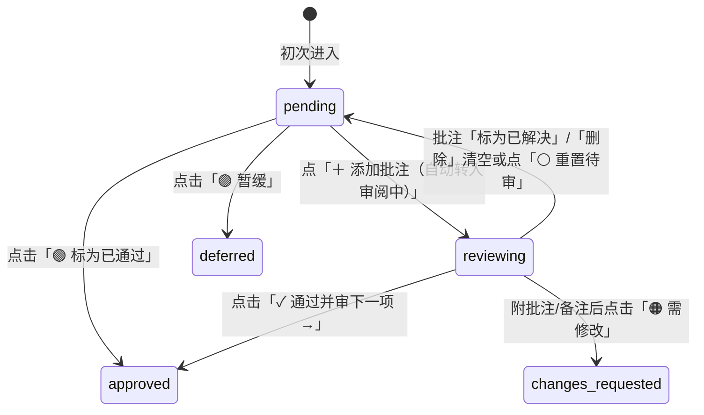
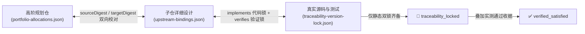

# Skill Family Studio 操作手册（零基础逐按钮指南）

> 不用背命令行、不用猜读取顺序——一个本地端口统一搞定跨仓需求对齐、故事优先审阅、多波次任务树与多智能体会话编队。

## 一、这款工具解决什么问题

维护单个技能族仓库，或协作管理“1 个高阶规划仓 + 多个详设子仓”时，审阅与盯控通常需要理清四件事：上百份制品该按什么顺序阅读、每条需求是仅完成拆派还是已补齐代码与测试验证、长程任务推进到了哪一步、派出的多个子会话各自在执行什么。

Skill Family Studio 在同一本地回环端口（默认 `127.0.0.1:57630`）内提供完整视图：左上角通过「当前项目：<仓库名> ▾」切换仓库，可随时点「＋ 添加本地项目」接入新仓库或点「✎ 说明与来源」核对并覆写项目说明；中部并列三大主页签「📝 审阅与对齐」「🕸️ 制品图谱」「⚡ 运行监控」；右上角提供审阅进度与「导出 ▾」胶囊、「📖 手册」和「🌓 外观」。全站条目优先展示中文标题与正文摘要，表头「ⓘ」集中说明字段口径；所有批注、结论与项目覆写均保存在 Studio 自管目录（`.skill-family-studio/reviews.json` 与 `.skill-family-studio/workspace-projects.json`），不修改任何受审仓库受 Git 跟踪的文件。

## 二、零门槛开启：直接对智能体说一句话即可

你不需要记住任何启动参数，也不用先写配置文件。在正在工作的项目目录里直接对你的智能体（如 Antigravity / Claude Code / Codex）说出你的意图即可：

| 你的目的 | 对智能体说的一句话示例 |
| --- | --- |
| 想看全盘结构或开始审阅 | “打开工作台，带我看下这个项目的设计。” |
| 想核对需求拆分与实现对齐 | “打开逐项审阅，帮我核对需求进展和代码锁有没有漂移。” |
| 想盯长程任务和多智能体协作 | “打开运行监控，看看任务推进树和派出去的子会话跑到哪一步了。” |

- 第一步（静默体检）：智能体先只读运行环境探针（inspect-setup），自动识别当前目录属于单技能族仓库、高阶规划仓、详设子仓还是多仓父目录，同时探测是否已经绑定了上下游仓库或存在活跃运行源。
- 第二步（智能决策）：如果是无上下游绑定的单技能族项目，智能体默认只扫描当前这一个仓库（--scan-roots none），避免把父目录里无关仓库全塞进下拉框，直接拉起控制台并给你一条明确的固定审阅路线。
- 第三步（仅当必要时问一道三选题）：如果检测到当前仓已与上下游仓关联但还没有 .studio-workspace.json，智能体只用大白话问你一次三选一：① 仅聚焦当前仓；② 自动纳入关联上下游仓以支持跨仓互跳；③ 指定业务域扫描目录并由智能体代写配置。

### 两种工作模式（由智能体自动适配或代配）

#### 单技能族项目模式（聚焦本仓、零配置即开）

- **适用读者**：适合独立开发或验收单一技能族的开发者与审阅者
- **何时选用**：当你只关心当前这一个仓库里的“用户故事 / 需求 → 详设 → 代码与测试锁”全链路时使用。
- **工作方式**：系统自动只读取本仓 artifact-graph.config.yaml 与标准 artifacts/ 目录（故事、需求、场景、架构与代码测试锁），不混入父目录里其他项目，同时在「📝 审阅与对齐」第 ① 步体检本仓核心源码和 SKILL.md 入口是否都已被版本锁认领，一键点「下一步：开始逐篇审阅正文 →」即入第 ② 步正文签收。

#### 业务域多仓套组模式（1 个高阶规划仓 + N 个子技能族详设仓）

- **适用读者**：适合跨仓规划架构师、产品负责人与多仓协同团队
- **何时选用**：当一个业务域由“1 个高阶规划仓（总体需求与业务流程） + 多个子技能族仓（各自落地详设与代码）”组成时使用。
- **工作方式**：由智能体代写或在项目根目录放置 .studio-workspace.json（也可写在 artifact-graph.config.yaml 顶层 studio 节），声明跨组扫描目录 scanRoots、自然分组名 groupLabels 与扩展故事/Archify 集合 collections。即可在同一界面查看「需求进展与双向对齐总览表」并实现一键跨仓互跳。

## 三、按你的角色选一条操作路线

### 路线一：产品负责人 / 业务需求验收（4 步完成签收）

> 适合刚接手项目、需要按“诉求 → 拆解去向 → 验收结论”逐项核对全部设计的人，按顺序点击按钮即可完成审阅。

1. **在顶栏左上角确认、添加或编辑当前项目**：点击左上角「当前项目：<仓库名> ▾」展开列表，可用顶部「输入仓库名、分组或说明过滤…」筛选并点「＋ 添加本地项目」运行期零侵入纳入新仓库，同时查看各仓库分层与底座版本对齐徽章（「🟠 支撑仓底座待同批拉齐」或「ℹ️ 可选底座新版本」）；点顶栏或列表中的「✎ 说明与来源」可核对项目说明来自 `package.json#description` 还是 `README.md` 首段，并支持「💾 保存自定义说明」「恢复默认来源」或「从列表移除该项目」；点空白处或按 Escape 收起。紧邻其右是「[角色徽章] ⓘ」和「[版本锁状态] ⓘ」。
2. **核对「① 核对需求与代码对齐」**：进入「📝 审阅与对齐」，顶部即见「① 核对需求与代码对齐 ──▶ ② 按顺序逐篇审阅 ──▶ ③ 导出验收结论」三步引导条。第 ① 步表格每行先展示中文标题与正文摘要，列表头配有「ⓘ」查看「业务处置与承接去向」「实际满足度（机器派生）」规则（当单行下游承接超过 4 项时支持 `+N 展开` / `收起`）；可用「🔴 双向告警」筛选并点「↗ <子仓名> · <标题>」跨仓互跳。核对完点「下一步：开始逐篇审阅正文 →」进入第 ② 步。
3. **在折叠目录树中按「① 用户故事 → ③ 需求总纲」批注签收**：第 ② 步左栏按阅读顺位分为「① 用户故事」「② 生命周期讲解」「③ 需求总纲」「④ 场景剧本」「⑤ 领域模型与架构设计」「附：机器数据契约 (.json/.yaml · 自动跳过)」六个折叠分组，默认展开当前条目所在分组。搜索框支持「搜索标题、摘要或编号…」并自动穿透全部折叠分组。右侧正文顶部展示摘要与前置元数据，点击「▶ 跳至下一项待审条目 →」自动跳过机器契约；点标题旁的「#章节批注」填写意见后点「＋ 添加批注（自动转入审阅中）」（未提交内容自动标为「📝 草稿」），停靠栏「审阅签收 ⓘ」说明 5 种状态；确认无误点「✓ 通过并审下一项 →」（5 秒内支持撤销）。
4. **点击「③ 导出验收结论」完成交付**：审完可点流程条第 ③ 步「③ 导出验收结论」或顶栏「审阅进度：已通过 X · 审阅中 Y · 需修改 Z · 暂缓 W / 共 N 项  导出 ▾」拉起导出抽屉，点击「📋 一键复制 Markdown 验收单」（按钮提示「✓ 已复制」）或「⬇ 下载 Markdown 验收单」/「⬇ 下载 JSON 台账」，点「关闭 ✕」或按 Escape 退出。

### 路线二：架构师 / 技能族开发者（3 步全局对齐与排错）

> 适合改完详细设计或新增代码与技能入口后，快速确认上下游依赖没断链、代码已被版本锁认领、没有跨仓漂移。

1. **在「🕸️ 制品图谱」看全局依赖与嵌入式业务逻辑图**：点击工具栏「制品依赖图谱 (N)」看 6 层依赖（宽屏自动多列排布），点击任意节点全图坐标保持恒定并在右侧联动正文；可使用「仅看上下游关联子图」「－ / ＋」（支持 Ctrl/Cmd + 滚轮与画布拖拽）「重置视角」与「全屏画布」。切到「Archify 业务逻辑图 (M)」以嵌入式视图展示，顶栏同样提供「－ / 100% / ＋ / 1:1」缩放与复位（多图时用「◀ 上一张 / 下一张 ▶」切换，单图展示静态标题徽章），点击图上节点直跳右侧对应章节。
2. **检查代码锁认领与双向漂移**：进入「📝 审阅与对齐」第 ① 步「① 核对需求与代码对齐」，核对 UNALLOCATED_ACTIVE_DEMAND、UPSTREAM_DESIGN_CHANGED、DOWNSTREAM_DESIGN_EVOLVED 与下方单仓内部体检的 UNCLAIMED_IMPLEMENTATION_ENTRY（悬停「ⓘ」即可看人话定义）。
3. **跨仓对照正文并核对同源 JSON 契约**：点总览表「↗ <子仓名> · <编号>」或子仓正文顶部「↖ <高阶仓名> · <编号>」跨仓对照原文；核对字段约束时点击正文互跳条「🗂️ 查看对应的结构化数据契约（...）→」或「📖 切换到对应的人读版 Markdown 文档（...）→」，并在「📊 结构化可读摘要」与「{ } 原始源码」间切换。

### 路线三：长程任务与多智能体监督（3 步盯控）

> 适合你让主智能体拆了好几个波次或派出一队子智能体干活，想直观掌握推进卡点、协作往来和每条委派详情时使用。

1. **在双栏主从视图「🌳 任务推进树」查看活跃与历史执行计划**：进入「⚡ 运行监控」默认采用双栏主从详情视图：左侧「🌳 执行计划清单」聚合活跃计划、实时沙箱以及本工作区与相邻规划目录近期进行中与已完成的历史执行计划，支持「全部 / 进行中 / 已完成」过滤、「搜索计划标题、摘要或仓库…」与「＋ 挂载」运行源；右侧即刻展开所选计划进度与「全部任务树」「仅看未完成」「聚焦当前活跃链路」（「按波次、编号或步骤关键词过滤…」自动穿透折叠节点，0 匹配提供「🔄 清空筛选条件」）。若无计划且本机已有编队，直接提供「🛰️ 查看本机 N 组智能体会话 →」与「▶ 运行隔离沙箱演练」。
2. **看「🛰️ 智能体会话编队」双栏掌握多智能体协同全貌**：切到第 2 子页签，左侧「🛰️ 会话编队」以可视化卡片列出各编队清洗后的标题与中文摘要（支持按宿主「全部 / Antigravity / Claude / Codex」过滤、「筛选编队标题、摘要或仓库…」与「↻ 刷新日志」）；点击左侧任意会话卡右侧立刻展示 4 KPI、「🕸️ Agent 会话网络」、「🔀 跨会话协作泳道」（支持「已锁定会话：<名称> ×」「搜索会话…」「最早」「最新」）、「📋 协作任务」及底部「🔎 事件检查」（「搜索事件内容…」「原文」「Markdown」「📋 复制」「🔄 清空筛选条件」）。
3. **看到「🟢 无卡死」可放心跳过「🩺 异常排障」**：子页签自带实时健康灯：「🩺 异常排障 (🟢 无卡死)」表示一切正常，平时无需点开；仅当变成「(⚠️ N 告警)」或长久停滞时点开查看超时排他文件锁（不包含静态版本锁）、state-store 哈希链与 supervise-process 轨迹。沙箱演练锁可直接在右上角点击「🔓 释放沙箱锁」解除。

## 四、逐页界面全拆解（每个区域是什么、什么时候看、怎么用）

### 全局顶栏（所有页面固定可见）

- **什么时候看这里**：无论处于哪个页签，随时切换仓库、识别角色健康度、导出成果或按需翻阅手册。
- 左侧「当前项目：<仓库名> ▾」切换器（支持顶部「输入仓库名、分组或说明过滤…」「＋ 添加本地项目」、每项中文简介与「✎ 说明与来源」弹窗及右侧「已审 X/Y」）+「[角色徽章] ⓘ」+「[版本锁状态] ⓘ」+ 快捷「✎ 说明与来源」按钮；点空白或按 Escape 收起。
- 居中三大业务主导航：「📝 审阅与对齐」「🕸️ 制品图谱」「⚡ 运行监控」。
- 右侧功能区：进度胶囊「审阅进度：已通过 X · 审阅中 Y · 需修改 Z · 暂缓 W / 共 N 项  导出 ▾ ⓘ」（点击展开导出抽屉，含「📋 一键复制 Markdown 验收单」「⬇ 下载 Markdown 验收单」「⬇ 下载 JSON 台账」「关闭 ✕」）、按需「📖 手册」与「🌓 外观」。

### 🕸️ 制品图谱页（全局结构与关系视图）

- **什么时候看这里**：第一次熟悉陌生项目架构、核对需求到场景/测试的连线、或对照 Archify 业务逻辑图阅读时使用。
- 工具栏左区：「制品依赖图谱 (N)」与「Archify 业务逻辑图 (M)」（有业务图时出现，旁附「ⓘ」）以及「▶ 开始按推荐顺序审阅」。
- 工具栏右区：DAG 模式下默认开启自适应宽屏折行排布，提供「仅看上下游关联子图」「－ / 只读比例 / ＋」（另支持 Ctrl/Cmd + 滚轮与画布拖拽）「重置视角」（一键复位缩放与位移）「全屏画布」；Archify 模式传 &embed=1 内嵌展示，同样保留「－ / 100% / ＋ / 1:1」缩放控件与「全屏画布」，多图时显示「◀ 上一张 / 下拉框 / 下一张 ▶」，单图显示静态标题徽章。
- 防跳变定位条与右侧联动区：点击任意节点画布坐标保持不变，全屏下无论焦点是否在 iframe 内均可直接按 Escape 或点「退出全屏对照右侧正文 →」回到双栏对照。

### 📝 审阅与对齐页（三步对齐与签收）

- **什么时候看这里**：核对需求拆分与代码双锁对齐、按阅读顺位逐篇批注并导出验收结论时使用。
- 顶部三步流程图条：「① 核对需求与代码对齐 ──▶ ② 按顺序逐篇审阅 (已审 X/N) ──▶ ③ 导出验收结论」，第 ② 步右上角提供「▶ 跳至下一项待审条目 →」。第 ① 步列表头「ⓘ」统一说明列口径与全部枚举规则，表格行首展示中文标题、摘要与路径，「下一步：开始逐篇审阅正文 →」直达第 ② 步，0 匹配提供「🔄 清空筛选条件」。
- 逐篇阅读左栏折叠目录树：支持「搜索标题、摘要或编号…」穿透搜索、「状态过滤」及六个按优先级排列的手风琴夹（「① 用户故事」「② 生命周期讲解」「③ 需求总纲」「④ 场景剧本」「⑤ 领域模型与架构设计」「附：机器数据契约 (.json/.yaml · 自动跳过)」）；未提交草稿跨篇保留并标出「📝 草稿」，0 匹配左右同步提示「🔄 清空筛选条件」。
- 正文 Hero 卡与停靠批注区：顶部以 Hero 摘要卡展示编号/状态/简介与前置元信息，正文采用标题左竖线与 Callout 提示框（舒适阅读最大宽度 1040px 居中排布），提供「✓ 通过并审下一项 →」（及同源「📖 切换到对应的人读版 Markdown 文档」「🗂️ 查看对应的结构化数据契约」「📊 结构化可读摘要 / { } 原始源码」「↖ 上游高阶来源」）；停靠栏提供「审阅签收 ⓘ」与「🟢 标为已通过」「🔵 标为审阅中」「🟠 需修改」「🟣 暂缓」「⚪ 重置待审」「审阅结论备注」「＋ 添加批注（自动转入审阅中）」及「标为已解决 / 重新打开 / 删除」（带 5 秒撤销提示）。

### ⚡ 运行监控页（健康灯与空态分流观测台）

- **什么时候看这里**：实时盯控长程任务树、追踪多智能体会话委派与回报、管理自挂运行源或排障超时锁时使用。
- 紧凑双层顶栏：第一层放置子页签「🌳 任务推进树」「🛰️ 智能体会话编队 (N)」「🩺 异常排障 (🟢 无卡死 / ⚠️ N 告警)」与右侧「SSE 实时同步」「▶ 运行隔离沙箱演练」（持锁时展示「🔓 释放沙箱锁」）；第二层放置「聚焦当前项目 / 全工作区监控源聚合」「+ 挂载运行源」及自定义运行源「✏️ 编辑 / 🗑️ 移除」。
- 🌳 任务推进树（双栏主从详情）：左侧「🌳 执行计划清单」汇集活跃计划与工作区近期进行中及已完成历史计划（「搜索计划标题、摘要或仓库…」+「＋ 挂载」）；右侧展示进度条、焦点横幅与多级树（「全部任务树 / 仅看未完成 / 聚焦当前活跃链路」「按波次、编号或步骤关键词过滤…」自动穿透折叠波次，0 匹配提供「🔄 清空筛选条件」）。
- 🛰️ 智能体会话编队 & 🩺 异常排障：编队页左侧「🛰️ 会话编队」按宿主与关键词筛选卡片（「筛选编队标题、摘要或仓库…」「↻ 刷新日志」），右侧分段联动展示「已锁定会话：<名称> ×」「🕸️ Agent 会话网络」「🔀 跨会话协作泳道」（「搜索会话…」「最早」「最新」）「📋 协作任务」与底部「🔎 事件检查」（「搜索事件内容…」「原文 / Markdown / 📋 复制」「🔄 清空筛选条件」）；排障页明细表以「发现来源」区分自动发现、沙箱演练与手动挂载。

## 五、状态流转图、三层双向互锁原理图与防呆速查

### 1. 审阅五态流转图（自动感知与手动签收）



| 状态标识 | 触发与自动感知条件 | 业务含义 |
| --- | --- | --- |
| **⚪ 待审阅** (`pending`) | 尚未写过任何未解决批注，也未给出终态审阅结论；或者点击「⚪ 重置待审」清空备注并清除旧结论（若此时仍有未解决批注，系统会弹窗提示并保持为「🔵 审阅中」）。 | 表示这篇制品还没有进入实质审阅，会排在「▶ 跳至下一项待审条目 →」队列最前面。 |
| **🔵 审阅中** (`reviewing`) | 阅读时点击「＋ 添加批注（自动转入审阅中）」新增至少 1 条未解决批注（自动感知点亮），或主动点击「🔵 标为审阅中」作为阅读书签。 | 表示审阅者正在边读边记问题、尚未定稿收尾；一旦所有批注「标为已解决」或「删除」清空且未给终态结论，会自动回到「⚪ 待审阅」。 |
| **🟠 需修改** (`changes_requested`) | 写好至少一条批注或填写上方「审阅结论备注」后点击「🟠 需修改」提交结论（若批注与备注全空，系统会自动拦截提示以防误标空退回）。 | 明确要求作者依据批注返工修订，导出验收单时会归入待整改项。 |
| **🟢 已通过 / 🟣 暂缓** (`approved / deferred`) | 主动点击「🟢 标为已通过」（或顶部「✓ 通过并审下一项 →」，支持 5.5 秒内点「撤销并回到该篇」或「撤销刚才操作」）完成签收，或点击「🟣 暂缓」留待后续轮次。 | 当前轮次已有明确裁决，自动引导动线会跳过该篇并定位下一篇未签收条目。 |

### 2. 高阶 ⇄ 详设 ⇄ 代码测试三层双向互锁图



| 满足概况徽章 | 机器派生依据与业务含义 |
| --- | --- |
| **✅ 已验证满足** (`verified_satisfied`) | 下游全部承接目标存在、上下游摘要双向一致、traceability-version-lock.json 具备新鲜 implements + verifies 双锁，且同时检测到全量通过的测试执行收据（.release-skill/testing/requirements.json 对应的 .runs/release-testing/results.json 等 sft 实测回执，或只读冻结仓有效 verifiedReceiptPath）。绝不把静态有锁误当实测已过。 |
| **🔗 追溯双锁齐备** (`traceability_locked`) | 下游目标文件存在、上下游摘要双向一致，且具备新鲜的 implements 代码锁与非空 verifies 验证锁；但尚无真实测试执行通过收据，仅代表静态追溯锁齐备，等待跑通 sft / 发布测试后升为「✅ 已验证满足」。 |
| **🔵 部分覆盖** (`partially_allocated`) | 需求已拆出部分下游承接，但 remainingScope 仍列有未覆盖的剩余范围，界面会逐条标出尚未落地的部分。 |
| **⏳ 已派单推进中** (`allocated_in_progress`) | 需求已分配给下游技能族仓，但下游目标尚在完善、存在摘要漂移，或下游代码与测试锁尚未齐全验证。 |
| **⚪ 按处置不计满足** (`not_applicable`) | 该需求被明确处置为暂缓（deferred）、合并（merged）或废弃（abandoned），不会混入已满足比例中虚增进度。 |

| 告警徽章与错误码 | 识别到什么问题 | 推荐处理动作 |
| --- | --- | --- |
| **🔴 高阶漏拆** (`UNALLOCATED_ACTIVE_DEMAND`) | 高阶规划仓中有活跃（allocated）需求，但 allocations 列表为空，还没有任何子项目认领。 | 补齐目标子项目承接关系，或在详设确认后暂缓/合并该需求。 |
| **🟠 高阶已变待同步详设** (`UPSTREAM_DESIGN_CHANGED`) | 高阶需求原文自上次绑定以来发生过修订，子项目的详细设计尚未同步更新摘要。 | 点击下游胶囊跨仓进入子项目核对变动并更新详设与 upstream-bindings.json。 |
| **🟠 详设已演进待回写高阶** (`DOWNSTREAM_DESIGN_EVOLVED`) | 子项目在编写手册或实现中演化了详设内容，但高阶规划仓的 portfolio-allocations.json 记录的还是旧摘要。 | 点击「↖ 上游高阶来源」回到高阶规划仓核实影响，并刷新双向绑定锁。 |
| **🟠 单仓代码/技能未认领** (`UNCLAIMED_IMPLEMENTATION_ENTRY`) | 单仓匹配 implementationSurface.entryGlobs 的核心源码或 SKILL.md 入口文件，尚未在 traceability-version-lock.json 中绑定任何 @feature / @scenario 锁。 | 在对应源码或技能顶部补齐追溯注解并运行 artifact-graph version-lock refresh --all。 |

### 3. 常用操作防呆与快捷键速查

| 快捷键 / 触发行为 | 精确结果与防呆保护 |
| --- | --- |
| `Cmd / Ctrl + K（⌘K）` | 全局快速聚焦搜索框：在「📝 审阅与对齐」聚焦左侧条目或对齐搜索框，在「⚡ 运行监控」聚焦计划或会话搜索框，在其他视图自动展开「当前项目」切换器并聚焦仓库过滤框。 |
| `Escape` | 按优先级依次关闭当前打开的浮层或全屏视图：「ⓘ」解释气泡 → 「添加项目 / 说明与来源」弹窗 → 「+ 挂载运行源」弹窗 → 导出抽屉 → 「当前项目」下拉 → 图谱「全屏画布」（在 Archify 内嵌画面聚焦时按 Escape 同样生效）。 |
| `Enter（审阅结论备注框内）` | 立即保存备注与当前结论；若批注输入框中仍有未点击添加的草稿，会先自动保全并落盘，绝不静默丢字。 |
| `跨跳转草稿自动暂存（📝 草稿）` | 在批注框或备注框打字但未提交时，点击左栏切篇、切契约/人读版、上游回跳、切换主页签或切换仓库，草稿都会按仓库与条目编号实时暂存，切回即自动还原。 |
| `Ctrl / Cmd + 滚轮 & 重置视角（DAG 图谱）` | 平滑缩放 DAG 画布（40%–240%），中间数字徽章只读显示当前百分比，点击「重置视角」一键同时归零缩放与拖拽位移。 |
| `0 匹配快速恢复（🔄 清空筛选条件）` | 对齐总览、逐篇审阅左栏（同步提示右侧正文区）、任务推进树与编队事件检查在搜索或筛选得到 0 项时，均就地提供「🔄 清空筛选条件」一键恢复；任务树搜索关键词时会自动穿透展开已折叠分支。 |
| `批注防丢字、空退回拦截与全状态撤销` | 点「🟠 需修改」前须已有未解决批注或备注；点「⚪ 重置待审」时若仍有未解决批注，会弹出提示条说明原因并保持「🔵 审阅中」；单篇与连续签收均提供 5 秒撤销按钮。 |

## 六、高频疑问解答 FAQ

### Q：为什么项目下拉框里默认只显示当前这一个仓库？怎样同时查看多个关联仓库？

A：在没有绑定上下游关系的独立单仓启动时，智能体默认传入 `--scan-roots none` 只聚焦当前仓库，避免混入同级目录中的无关项目。需要同时审阅多个仓库时，可在下拉框点击「＋ 添加本地项目」，或对智能体说“帮我把关联的上下游仓库也纳入工作台”以生成 `.studio-workspace.json`。

### Q：点击图谱节点或切换审阅条目时，画布位置、滚动进度和未提交草稿如何保持？

A：图谱采用固定坐标布局：点选节点只原地高亮关联连线、更新顶部位置提示并在右侧加载正文，节点位置保持不变；审阅页切换或提交批注时保留左栏与侧栏当前滚动进度，未提交的批注和备注也会自动按条目暂存。

### Q：列表最下面「附：机器数据契约 (.json/.yaml · 自动跳过)」是什么？审阅时一定要一个个点开吗？

A：它们是供自动化脚本、状态机检查与门禁校验读取的结构化数据契约，点击「▶ 跳至下一项待审条目 →」或「▶ 开始按推荐顺序审阅（故事 → 需求 → 场景）」会自动跳过它们、优先带你读完人读 Markdown 文稿。当你想核对字段细节时点开即可，界面默认整理为「📊 结构化可读摘要」，且顶部支持「📖 切换到对应的人读版 Markdown 文档（...）→」与「{ } 原始源码」切换。

### Q：日常监督长程任务时，「🩺 异常排障」里的文件锁与哈希链什么时候才需要看？

A：平时看进度只盯第一页签「🌳 任务推进树」和第二页签「🛰️ 智能体会话编队」就够了，只要第三页签亮着「(🟢 无卡死)」就无需点入。只有当它变成「(⚠️ N 告警)」或怀疑有未释放的排他写锁阻断后续步骤时再点开排查；演练锁可直接点运行监控右上角「🔓 释放沙箱锁」解除，自定义挂载源也可就地「✏️ 编辑」或「🗑️ 移除」。

### Q：我在界面里点「🟢 标为已通过」或记了好多批注，会不会弄脏受审项目的 Git 工作区？

A：不会。所有审阅结论和批注都统一存放在工作台启动根目录的 .skill-family-studio/reviews.json 中，受审兄弟仓库完全保持只读、零写入。

<details>
<summary>附录：脚本自动化 CLI 与 `.studio-workspace.json` 配置参考（日常由智能体代劳，按需展开）</summary>

```bash
# 只读探测当前仓库角色（单仓 / 高阶仓 / 详设子仓）与推荐启动参数
npx skill-family-studio inspect-setup --root /absolute/project/path --json

# 按单仓或关联套组安全生成 .studio-workspace.json
npx skill-family-studio init-workspace --root /absolute/project/path --mode related

# 幂等守护启动或复用单端口控制台（若已有实例未收录当前仓，会自动隔离分配空闲端口）
npx skill-family-studio ensure --root /absolute/project/path --port 57630

# 离线导出设计态、双向对齐与运行态快照
npx skill-family-studio snapshot --root /absolute/project/path

# 核验本地 Node.js 版本、离线前端资产与仓库发现状态
npx skill-family-studio doctor --root /absolute/project/path
```

声明式多仓配置 `.studio-workspace.json` 示例（可放在高阶规划仓根目录，或等价写入 `artifact-graph.config.yaml` 顶层 `studio` 节）：

```json
{
  "schemaVersion": "1.0",
  "role": "portfolio",
  "title": "我的业务域规划工作区",
  "scanRoots": ["..", "../sub-skills"],
  "groupLabels": { "my-domain": "业务域技能族" },
  "collections": [
    { "id": "domain-stories", "kind": "lifecycle-story-pack", "storiesJson": "artifacts/stories/stories.json", "explanationsDir": "artifacts/stories/explanations" },
    { "id": "business-diagrams", "kind": "archify-model-scenes", "manifestJson": "artifacts/diagrams/model-and-scenes.json" }
  ]
}
```

</details>
